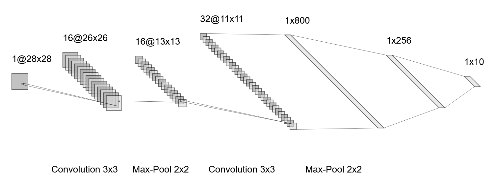

# CUDA Neural Network

Simple convolutional neural network in CUDA C++. 

## Table of Contents

- [Installation](#installation)
- [Usage](#usage)

## Installation

Download to your project directory, make sure you have the latest version of `nvcc` installed:

```sh
nvcc .\main.cu -o network.exe
```

> [!NOTE]
> Project uses `stb_image.h` for image processing, which is not included in repo files.

To compile with image loading support make sure to add `./network/file/stb_image.h`.

To compile without image loading support use `-DNN_NO_IMAGES` flag.

## Usage

You can use command line to run the program with given parameters.

To configure network structure, a `layer_config_string` is used. It contains information about all layers in the network, as well as layers' properties. For more details on layer config see [project wiki](https://github.com/sv022/CudaNN/wiki) _(in development)_.

Example of a config string with a visualisation:

```sh
conv_28x28x1_3_16_1_0-activation_relu-pool_26x26x16_2_2-conv_13x13x16_3_32_1_0-activation_relu-pool_11x11x32_2_2-dense_800_256-activation_sigmoid-dense_256_10-activation_softmax
```



Args list for training:
```sh
<mode (TRAIN=1)> <layer_config_string> <optimizer> <learning_rate> <loss_function> <epochs> <batch_size> <train_data_size> <test_data_size> <train_data_path> <test_data_path> <save_weights> <current_dir> <report_file_name>
```

Args list for testing:
```sh
<mode (TEST=0)> <layer_config_string> <test_data_size> <test_data_path> <weights_path> <current_dir> <report_file_name>
```

Args list for inference:
```sh
<mode (INFER=2)> <layer_config_string> <test_data_path> <weights_path> [<c> <h> <w>]
```


`<weights_path>` is the path to `.bin` file that contains weights that will be loaded and used in the model.

`<current_dir>` is where weights and report files will be saved in `./runs` subdirectory for TRAIN, `./predict` subdirectory for TEST.

`<report_file_name>` will be used to generate the report file after the run is completed. Using '-' will automatically generate report name using datetime. 

Example (`run_train.bat`):

```bat
@echo off
REM Example script for launching network.exe.

set EXE_PATH=.\network.exe
set MODE=1
set LAYER_CONFIG="conv_28x28x1_3_16_1_0-activation_relu-pool_26x26x16_2_2-conv_13x13x16_3_32_1_0-activation_relu-pool_11x11x32_2_2-dense_800_256-activation_sigmoid-dropout_0.5-dense_256_10-activation_softmax"
set OPTIMIZER=sgd
set LEARNING_RATE=0.05
set LOSS=cce
set EPOCHS=5
set BATCH_SIZE=128
set TRAIN_SIZE=60000
set TEST_SIZE=10000
set TRAIN_PATH=D:/path/to/digits-mnist_train.csv
set TEST_PATH=D:/path/to/digits-mnist_test.csv
set SAVE_WEIGHTS=1
set WEIGHTS_PATH=-
set CURRENT_DIR=D:/results/are/saved/here
set REPORT_FILE_NAME=-

%EXE_PATH% %MODE% %LAYER_CONFIG% %OPTIMIZER% %LEARNING_RATE% %LOSS% %EPOCHS% %BATCH_SIZE% %TRAIN_SIZE% %TEST_SIZE% %TRAIN_PATH% %TEST_PATH% %SAVE_WEIGHTS% %WEIGHTS_PATH% %CURRENT_DIR% %REPORT_FILE_NAME%
```

Example (`run_test.bat`):

```bat
@echo off
REM Example script for launching network.exe.

set EXE_PATH=.\network.exe
set MODE=0
set LAYER_CONFIG="conv_28x28x1_3_16_1_0-activation_relu-pool_26x26x16_2_2-conv_13x13x16_3_32_1_0-activation_relu-pool_11x11x32_2_2-dense_800_256-activation_sigmoid-dropout_0.5-dense_256_10-activation_softmax"
set TEST_SIZE=10000
set TEST_PATH=D:/path/to/digits-mnist_test.csv
set WEIGHTS_PATH=D:/path/to/saved_weights.bin
set CURRENT_DIR=D:/results/are/saved/here
set REPORT_FILE_NAME=digits_test_results

%EXE_PATH% %MODE% %LAYER_CONFIG% %TEST_SIZE% %TEST_PATH% %WEIGHTS_PATH% %CURRENT_DIR% %REPORT_FILE_NAME%
```

## Supported data formats

Module `file.cuh` provides data loaders for several dataset formats. For more details on each format see [project wiki](https://github.com/sv022/CudaNN/wiki) _(in development)_.

| Format | Pixels |  Layout |     Note    |
| ------ | -------| --------| ----------- |
|  csv   | float  | CHW RGB | Header as first row;<br>Pixels normalized by 255  |
|  bin   | uint8  | CHW RGB | Includes dataset meta  |
|  raw   |  raw   | CHW RGB | Uses `labels.txt` to process folder  |